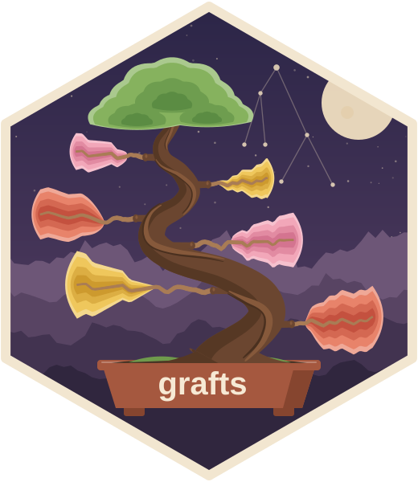

<!-- README.md is generated from README.Rmd. Please edit that file -->

```{r, include = FALSE}
knitr::opts_chunk$set(
  collapse = TRUE,
  comment = "#>",
  fig.path = "man/figures/README-",
  out.width = "100%"
)
```

# grafts <a href="https://pkg.mitchelloharawild.com/grafts/"></a>

<!-- badges: start -->
[](https://lifecycle.r-lib.org/articles/stages.html#experimental)
[](https://github.com/mitchelloharawild/grafts/actions/workflows/R-CMD-check.yaml)
<!-- badges: end -->

grafts (**gra**ph **f**orecasts for **t**ime **s**eries) explores aggregated
time series, such as hierarchical and grouped series, through their graphs.

## Installation

You can install the development version of grafts from
[GitHub](https://github.com/mitchelloharawild/grafts) with:

``` r
# install.packages("pak")
pak::pak("mitchelloharawild/grafts")
```

## Example

`graph_explore()` starts the app in the background and opens it in a browser.
Stop it with `plumber2::api_stop()` before starting another.

```{r example, eval = FALSE}
library(grafts)
library(fable)

# Trips are recorded in thousands
tourism_agg <- aggregate_key(
  tsibble::tourism, Purpose * (State / Region), Trips = sum(Trips) * 1e3
)

# The structure is inferred from the keys: Purpose * (State / Region)
app <- graph_explore(tourism_agg)
plumber2::api_stop(app)

# With forecasts, drawn after the data with their intervals
tourism_fit <- model(tourism_agg, ets = ETS(Trips), snaive = SNAIVE(Trips))
tourism_fc <- forecast(tourism_fit, h = "2 years")
app <- graph_explore(tourism_agg, forecasts = tourism_fc)
```

## The explorer

`graph_explore()` serves a browser app with
[plumber2](https://posit-dev.github.io/plumber2/). The app has two columns:

- **Left:** the series graph, drawn on demand, above the dimension graph,
  which is headed by the structure (`Purpose * (State / Region)`) with the
  keys last split by underlined; its edges in use show the path taken. Click
  a node to choose how to split it (its dimension-graph node's out-edges).
  Right-click to collapse it, and shift-click to pin it (pinned nodes carry an
  orange dot). Drag the background to pan and scroll (or pinch) to zoom;
  double-click the background or use the corner buttons to reset the view.
  The **?** button lists these shortcuts. When a series is reached by two
  paths, it gains a second parent instead of a copy, and its plot a merge
  icon.
- **Right:** the focused series, with forecasts when a fable is given. Its
  header holds the measure and the forecast models, whose chips are the
  legend and switch each model and the intervals on or off. Below it
  is a view of a set of series: either the focus's last chosen children or the
  pinned series, switched at the front of its header. Each set keeps its own
  scales and sort. The views are:
  - **Grid:** small multiples with free, shared or log y, or as shares of the
    parent (of the total, for pinned series), each with a bar of its share of
    the parent's (or total's) history total.
  - **Overlay:** values, or indexed to 100 at the first period, on a linear or
    log axis. Beyond eight series the largest keep a colour and the rest are
    thin grey lines.
  - **Stacked** (children only, since pinned series don't add up to a whole):
    totals or shares of the parent. The largest children sit nearest zero,
    negative values go below it, and children beyond the eighth colour merge
    into one "Other" band. Totals carry on with the first shown model's
    forecasts, so you can check that they add up to the parent's.
  - **Season:** season plots with free or shared y; the focused series' own
    before it is split.

  Notes join the legend: the parent's dashed line and the forecasts when
  stacked, and a chip of how many values a log axis leaves out (those at or
  below zero), whose tooltips explain them. Each view's
  scale options sit beside its tab, and the views that don't stack can sort the
  series by key, size or growth (the last cycle's mean over the one before).
  Pin a series with 📌 on its plot (or shift-click its node), or pin all the
  children at once; pinning while the children are drawn flashes the Pinned
  count. Click a plot to focus its series.
  Hovering a node highlights its time plot wherever it is drawn, or shows a
  sparkline of it beside the node when it isn't drawn.

Every pane can be resized by dragging the splitters (double-click a splitter to
reset it). The theme follows the system's light or dark setting, or a toggle
fixes it to either; the data palettes lighten on dark panes. Pane sizes, view
settings and the theme are remembered in the browser. The series graph's
header has buttons to reset the layout and switch the theme.

## What comes from the tsibble

- **Structure:** the key columns' `<aggregated>` patterns are the key
  combinations given to `aggregate_key()`. They are the dimension graph's
  nodes, and its edges each fix the fewest more keys, so any structure works.
  When the combinations cross chains of nested keys, as
  `Purpose * (State / Region)` does, those chains colour and lay out the graph.
- **Measures:** every numeric measured variable can be chosen in the app.
- **Time:** the index's own format labels the axis (`1998 Q1`). Its seasonal
  period (`fabletools::common_periods()`) gives the season plot and the
  yearly axis ticks. Implicit gaps break the lines.
- **Forecasts:** a fable's response, distribution and `.model` give each
  model's mean and `level` intervals, matched to series by key.

## Requirements

[plumber2](https://posit-dev.github.io/plumber2/) needs the system library libsodium
(`sudo apt install libsodium-dev` on Debian/Ubuntu).
