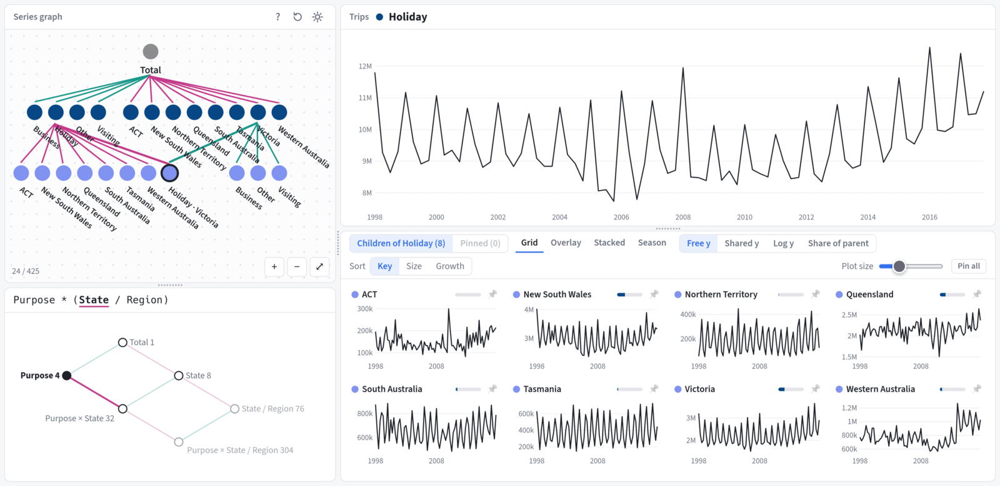

<!-- README.md is generated from README.Rmd. Please edit that file -->

# grafts <a href="https://pkg.mitchelloharawild.com/grafts/"></a>

<!-- badges: start -->

[](https://lifecycle.r-lib.org/articles/stages.html#experimental)
[](https://github.com/mitchelloharawild/grafts/actions/workflows/R-CMD-check.yaml)
<!-- badges: end -->

grafts (**gra**ph **f**orecasts for **t**ime **s**eries) is an
interactive browser app for exploring aggregated time series, such as
hierarchical, grouped and nested series, and their forecasts.

<figure>

<figcaption aria-hidden="true">The grafts explorer app</figcaption>
</figure>

## Installation

You can install the development version of grafts from
[GitHub](https://github.com/mitchelloharawild/grafts) with:

``` r
# install.packages("pak")
pak::pak("mitchelloharawild/grafts")
```

## Usage

grafts explores time series stored in a
[tsibble](https://tsibble.tidyverts.org/) whose keys have been
aggregated with `aggregate_key()`. Any structure of keys works, whether
hierarchical (`State / Region`), grouped (`Purpose * State`) or a mix of
both.

``` r
library(grafts)
library(fable)

tourism_agg <- aggregate_key(
  tsibble::tourism, Purpose * (State / Region), Trips = sum(Trips)
)
app <- graph_explore(tourism_agg)
```

`graph_explore()` opens the explorer in a browser. The data stays in R,
which serves each series only when it is drawn, so large collections of
series open quickly. The app runs in the background until it is stopped
with:

``` r
plumber2::api_stop(app)
```

To also explore forecasts, pass a [fable](https://fable.tidyverts.org/)
of forecasts for those series to `forecasts`. Each model’s forecasts and
intervals are drawn after the data.

``` r
tourism_fc <- tourism_agg |>
  model(ets = ETS(Trips), snaive = SNAIVE(Trips)) |>
  forecast(h = "2 years")
app <- graph_explore(tourism_agg, forecasts = tourism_fc)
```

## Exploring

The explorer starts from the total of all series. Its left side shows
the **series graph**, where each node is a series and its children sum
to it. Clicking a node lists the ways it can be split, such as by
`Purpose` or `State`, and choosing one adds those disaggregates to the
graph. Below it, the **dimension graph** shows the structure of keys and
highlights where the explorer is.

The right side plots the series being explored above its disaggregates,
which can be shown as small multiples, overlaid, stacked (to see what
each contributes to the total) or as seasonal plots. Clicking a time
plot focuses that series, and hovering a node highlights its series
wherever it is plotted. Right-clicking a node collapses its children,
and shift-clicking pins it so series from different parts of the graph
can be compared side by side.
