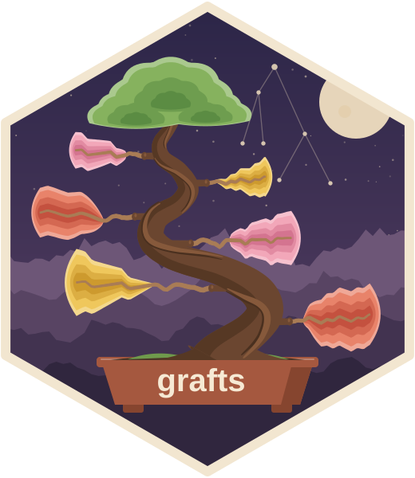
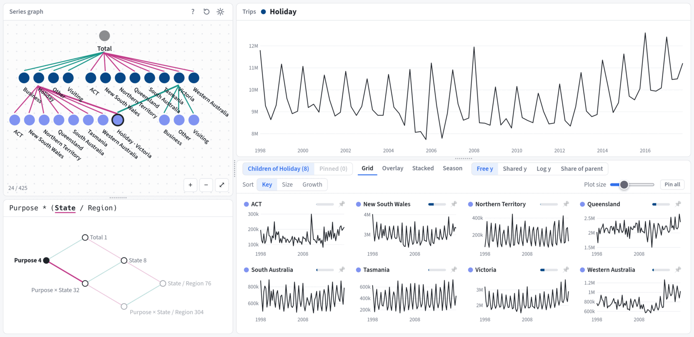

<!-- README.md is generated from README.Rmd. Please edit that file -->

# grafts <a href="https://pkg.mitchelloharawild.com/grafts/"></a>

<!-- badges: start -->

[](https://lifecycle.r-lib.org/articles/stages.html#experimental)
[](https://github.com/mitchelloharawild/grafts/actions/workflows/R-CMD-check.yaml)
<!-- badges: end -->

grafts (**gra**ph **f**orecasts for **t**ime **s**eries) is an
interactive browser app for exploring aggregated time series, such as
hierarchical, grouped and nested series, and their forecasts.

<figure>

<figcaption aria-hidden="true">The grafts explorer app</figcaption>
</figure>

## Installation

You can install the development version of grafts from
[GitHub](https://github.com/mitchelloharawild/grafts) with:

``` r
# install.packages("pak")
pak::pak("mitchelloharawild/grafts")
```

## Usage

grafts explores time series stored in a
[tsibble](https://tsibble.tidyverts.org/) whose keys have been
aggregated with `aggregate_key()`. Any structure of keys works, whether
hierarchical (`State / Region`), grouped (`Purpose * State`) or a mix of
both.

``` r
library(grafts)
library(fable)

tourism_agg <- aggregate_key(
  tsibble::tourism, Purpose * (State / Region), Trips = sum(Trips)
)
grafts(tourism_agg)
```

`grafts()` makes an explorer, which opens in the viewer or a browser
when printed in the console. The data stays in R, which serves each
series only when it is drawn, so large collections of series open
quickly. Like a Shiny app, the console waits while the explorer is open:
press Ctrl+C (or Esc in RStudio and Positron) to stop it.

To also explore forecasts, pass a [fable](https://fable.tidyverts.org/)
of forecasts for those series to `forecasts`. Each model’s forecasts and
intervals are drawn after the data.

``` r
tourism_fc <- tourism_agg |>
  model(ets = ETS(Trips), snaive = SNAIVE(Trips)) |>
  forecast(h = "2 years")
grafts(tourism_agg, forecasts = tourism_fc)
```

## Exploring

The explorer starts from the total of all series. Its left side shows
the **series graph**, where each node is a series and its children sum
to it. Clicking a node lists the ways it can be split, such as by
`Purpose` or `State`, and choosing one adds those disaggregates to the
graph. Below it, the **dimension graph** shows the structure of keys and
highlights where the explorer is.

The right side plots the series being explored above its disaggregates,
which can be shown as small multiples, overlaid, stacked (to see what
each contributes to the total) or as seasonal plots. Clicking a time
plot focuses that series, and hovering a node highlights its series
wherever it is plotted. Right-clicking a node collapses its children,
and shift-clicking pins it so series from different parts of the graph
can be compared side by side.

## Deploying

To serve the explorer from a server, add it to a plumber2 api with
`grafts_api()`, which takes an explorer from `grafts()`. In a plumber2
file, such as for Posit Connect:

``` r
#* @plumber
function(api) {
  grafts_api(api, grafts(readRDS("tourism_agg.rds")))
}
```

In Docker, listen on all interfaces:

``` r
readRDS("tourism_agg.rds") |>
  grafts() |>
  grafts_serve(host = "0.0.0.0")
```

Responses are cached privately and revalidated, `api/health` answers
load balancers, and the page’s links are relative, so the app works
behind a proxy that mounts it under a path prefix. `grafts_serve()`
listens on port 8000 (or `GRAFTS_PORT`/`PORT`), and has no sign-in, so
keep anything private behind an authenticating proxy. In Shiny,
`renderGrafts()` writes every series into the page, which suits small
data; for large data, link to a served explorer.

Several explorers can share one api by giving each a `path`, such as
`grafts_api(api, grafts(tourism_agg), path = "/tourism/")`.

## Embedding

Small collections of series can be explored without R, on a static web
page such as a pkgdown site, a blog or GitHub Pages. An explorer from
`grafts()` in an R Markdown or Quarto chunk, or in Shiny with
`renderGrafts()`, is written into the page with every series, and a page
can hold several explorers. `grafts_save()` writes one to a single HTML
file.

``` r
tourism <- grafts(tourism_agg, forecasts = tourism_fc,
                  options = grafts_options(height = 600))
tourism  # in a chunk
grafts_save(tourism, "tourism.html")
```

`grafts_options()` chooses the views offered, the starting view and
theme, and whether visitors’ choices persist, wherever the explorer
goes. Whether series add up to their parents is detected, hiding the
Stacked view and share scales for means.

``` r
grafts(tourism_agg, options = grafts_options(
  views = c("grid", "season"), theme = "dark", persist = FALSE
))
```

Every series is written into the page, so large collections are better
served from R, in the console or with `grafts_api()`. Embedded explorers
use the system’s UI font, unless the page loads [Source Sans
3](https://fonts.google.com/specimen/Source+Sans+3) as the app does.
